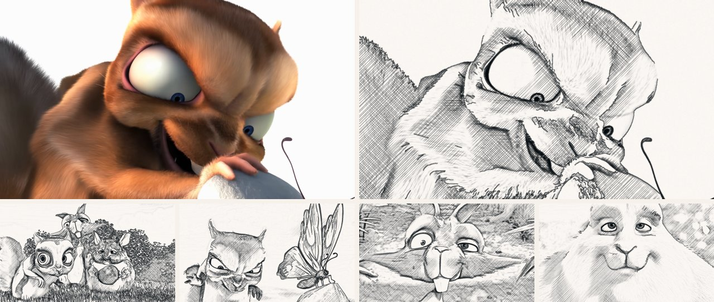

# scribble

Turn a video (or a YouTube link) into a pencil-and-ink sketch: one drawing per shot, a contact sheet of every shot, and the whole video redrawn in sketch style with its original audio.



## Install

You need [uv](https://docs.astral.sh/uv/) (Windows, macOS or Linux). It also fetches Python 3.10+ if you don't have it.

```shell
uv tool install git+https://github.com/rarrarrarr/scribble
```

This puts a `scribble` command on your PATH. It has its own isolated environment, so nothing is installed into your global Python, and the repo isn't needed afterwards. The dependencies are OpenCV, NumPy, [yt-dlp](https://github.com/yt-dlp/yt-dlp) and [imageio-ffmpeg](https://github.com/imageio/imageio-ffmpeg), which downloads an ffmpeg binary for you. A system ffmpeg on your PATH is used as a fallback.

Upgrade with `uv tool upgrade scribble-video`, and remove it with `uv tool uninstall scribble-video`. The package is named `scribble-video` because `scribble` on PyPI is an unrelated project; the command is still `scribble`.

## Usage

```shell
scribble "https://www.youtube.com/watch?v=aqz-KE-bpKQ"   # a link: downloaded first
scribble path/to/video.mp4                                # a local file
scribble path/to/video.mp4 --no-video                     # just the drawings, much faster
```

Quote links, since `&` is special to most shells.

### From source

```shell
git clone https://github.com/rarrarrarr/scribble
cd scribble
uv run scribble "https://www.youtube.com/watch?v=aqz-KE-bpKQ"
```

`uv run` creates a virtual environment in the repo (`.venv`) on first use, installs the versions pinned in `uv.lock`, and runs your working copy, so code changes take effect right away. It works from any folder inside the repo.

### Where files go

| Run as | Output and downloads |
| --- | --- |
| installed `scribble` | `~/scribble/`, with downloads in `~/scribble/source/` |
| `uv run scribble` in a clone | the repo's `scribble/` and `source/` folders, whichever folder you run it from |

To use another folder for both, set the `SCRIBBLE_HOME` environment variable. Outputs go in that folder and downloads in its `source/` subfolder. `-o` and `--download-dir` override this for a single run.

Each video gets its own folder, named after its title:

```text
<title-slug>/
  frames/frame_001_0m01.63s.png   one drawing per shot, from the middle of the shot
  contact_sheet.png               every shot on one page
  <title-slug>_scribble.mp4       the full video in sketch style, with original audio
  cuts.txt                        detected scene-cut times, in seconds
```

Links are downloaded into the `source/` folder, and running again reuses that file.

### Options

| Option | Default | |
| --- | --- | --- |
| `-o, --out DIR` | `<title-slug>` in the output folder | output folder for this video |
| `--no-video` | | skip the sketch video; only make the drawings and contact sheet |
| `--threshold N` | `0.3` | scene-change sensitivity, 0 to 1; lower finds more shots |
| `--min-shot SECONDS` | `0.25` | ignore shots shorter than this |
| `--crf N` | `24` | video quality; lower is better and bigger |
| `--encoder NAME` | `auto` | `nvenc` encodes on an NVIDIA GPU (needs a recent driver), `x264` on the CPU; `auto` uses the GPU when it works |
| `--preset NAME` | `slow` | x264 speed preset; `veryfast` renders about 20% sooner |
| `--workers N` | CPU threads, at most 12 | frames sketched in parallel; `1` for one at a time |
| `--cols N` | `6` | contact sheet columns |
| `--title TEXT` | video title | contact sheet title (also sets the folder name) |
| `--download-dir DIR` | the `source/` folder | where links are downloaded |
| `--max-height N` | `1080` | highest resolution to download |

Each run replaces that folder's previous drawings.

## Troubleshooting

- **Downloads fail:** YouTube changes often and older yt-dlp versions stop working. Update it with `uv tool upgrade scribble-video`, or in a clone with `uv lock --upgrade-package yt-dlp` (the next run installs the new version).
- **yt-dlp warns about a JavaScript runtime:** install [deno](https://deno.com) to silence it and make more formats available.

## Code layout

All in `src/scribble/`:

- `cli.py`: the `scribble` command; runs each step in order
- `sketch.py`: the sketch look and the contact sheet layout; edit this to change the style
- `ffmpeg_tools.py`: scene detection and video encoding
- `download.py`: downloading links with yt-dlp

## Use responsibly

Only download and process videos you have the right to use. YouTube's Terms of Service restrict downloading content without permission, and a sketched copy of someone else's video is still derived from their work.

## License

[MIT](LICENSE). The sample image above is from *Big Buck Bunny*, © 2008 Blender Foundation, [www.bigbuckbunny.org](https://www.bigbuckbunny.org), used under [CC BY 3.0](https://creativecommons.org/licenses/by/3.0/).
